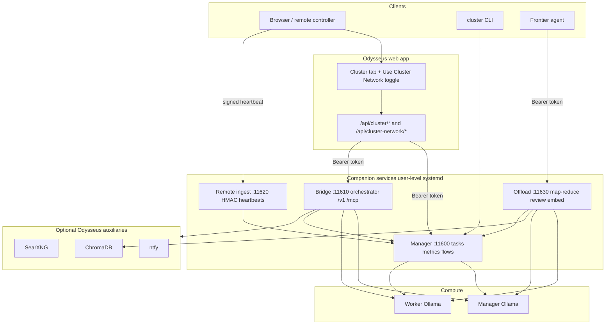

# Cluster Network — notes for Odysseus maintainers

This document is a handoff for upstream maintainers evaluating the optional Cluster Network work on `feature/cluster-network`. It is not a user setup guide. For install steps, architecture in more detail, and the author's [personal note](README.md#personal-note-from-the-author) and long-term vision, see [README.md](README.md).

The descriptions and much of the code on this branch were written with Grok Bot agents and reviewed by the author before being committed.

## Summary and motivation

Cluster Network is an **opt-in companion** that lets one Odysseus instance act as the hub for a multi-machine local LLM cluster: a Cluster tab with a live chain-of-command map and telemetry, a "Use Cluster Network" chat toggle that plans work on a manager model and dispatches subtasks to worker machines, hardware onboarding, and an authenticated offload endpoint so frontier agents can hand token-heavy summarization, map-reduce, and first-pass review to local hardware.

The motivation is self-hosting and using the hardware you already have. Simpler tasks stay on machines you can see and control, instead of being sent straight to a hosted model. As models improve, older and varied machines stay useful, so the ecosystem does not narrow to a few clouds and only the newest hardware. The author's fuller wording is in the [personal note](README.md#personal-note-from-the-author); this document does not repeat it.

The feature is **off by default** (`ODYSSEUS_CLUSTER_ENABLED=0`). A stock Odysseus install should behave as it does today: no Cluster rail button, no chat toggle, no endpoint registration, and no completion-gate bypass. Companion services live under `contrib/cluster-network/` and are installed separately, without `sudo`.

Branch: [`PupaboiFuccmin/odysseus` `feature/cluster-network`](https://github.com/PupaboiFuccmin/odysseus/tree/feature/cluster-network), intended to be proposed against `odysseus-dev/odysseus` `dev`.

## Core-file touchpoints

Counts below are `git diff --numstat origin/dev...HEAD` for files outside `contrib/` (added / deleted). `contrib/cluster-network/` is the bulk of the branch (~9.6k lines) and is not listed here. Line counts for `README.md` include the maintainer link added with this document.

| File | + / − | Why it is needed | How it is gated by `ODYSSEUS_CLUSTER_ENABLED` |
|---|---|---|---|
| `app.py` | 16 / 0 | Includes the two new routers (wrapped in `try/except` so a missing module cannot break startup) and adds `GET /cluster`, matching other tab routes that all serve `index.html`. | Routers are always included when the files exist. Every behavioral path inside them checks the flag. `GET /cluster` always serves the SPA; the rail button and panel are not inserted unless the flag is on. |
| `routes/cluster_routes.py` | 1372 / 0 | New same-origin proxy for the Cluster tab: nodes, logs, tasks, metrics, change log, offload stats, and onboarding. The browser never talks to the companion manager directly. | `GET /api/cluster/config` always returns `{enabled: false, ...}` when the flag is off. Every other `/api/cluster/*` route returns **404** when the flag is off, and requires `require_admin` when it is on. |
| `routes/cluster_network.py` | 654 / 0 | Registers the shared "Cluster Network" model endpoint, and exposes `/config`, `/hosts`, and `/session` for the chat toggle, host-grouped picker, reply footers, and remote-session banner. | `ensure_cluster_endpoint()` runs only when the flag is on (and `ODYSSEUS_CLUSTER_NETWORK` is not `0`). Config/hosts/session return `enabled: false` and an empty catalog when off, so the picker is unchanged. |
| `routes/chat_routes.py` | 1 / 1 | The thinking-mode toggle now keys off the turn's `selected_model` instead of only the session model, so a Cluster Network turn can keep thinking on. | Not flag-gated. The behavior change is one expression and only matters when the selected model id is one that supports the thinking toggle (including `cluster-network`). |
| `src/agent_runtime/completion.py` | 14 / 0 | Lets `cluster-network` turns skip the Odysseus completion gate so the orchestrator can plan, review, and stream its own activity. `ODYSSEUS_CLUSTER_NETWORK_GATE=1` restores the gate for debugging. | `_cluster_network_turn()` is false unless the flag is on, the model is exactly `cluster-network`, and the gate override is not set. Other models are unchanged. |
| `src/model_profiles.py` | 2 / 0 | `supports_user_thinking_toggle("cluster-network")` is true so the chat UI can show the thinking switch on orchestrated turns. | Not flag-gated; it only affects the `cluster-network` model id. |
| `static/index.html` | 6 / 0 | Loads the three optional CSS/JS files (tab, toggle, host picker). | Assets are always referenced. Each script stays dormant until the corresponding `/api/*/config` reports `enabled: true`. |
| `static/sw.js` | 6 / 0 | Precaches those same CSS/JS files so the service worker manifest stays complete. | Precache entries are always present; they have no effect on UI unless the feature is enabled. |
| `static/css/18-cluster.css` | 83 / 0 | Cluster tab layout and map styles. | Unused until the tab boots. |
| `static/css/19-cluster-toggle.css` | 21 / 0 | "Use Cluster Network" switch styles. | Unused until the toggle boots. |
| `static/css/20-cluster-host.css` | 216 / 0 | Host-grouped picker, host badges, reply footer, and remote-session banner. | Unused until the host picker boots. |
| `static/js/cluster.js` | 903 / 0 | Cluster tab: rail button, chain-of-command map, device cards, logs, tasks, charts, add-device panel. | Returns immediately unless `GET /api/cluster/config` says `enabled: true`. No rail item, no polling. |
| `static/js/clusterToggle.js` | 162 / 0 | "Use Cluster Network" switch above the model picker. | Returns immediately unless `GET /api/cluster-network/config` says `enabled: true`. |
| `static/js/clusterHost.js` | 734 / 0 | Groups the model picker by host, writes `ran on` footers from SSE `cluster` metadata, and shows the remote-session banner. | No-ops unless the host catalog reports `enabled: true`. |
| `scripts/generate_env_reference.py` | 62 / 0 | Documents the new environment variables in the generated configuration reference. | Documentation only. |
| `website/configuration-reference.md` | 16 / 2 | Regenerated reference page for those variables. | Documentation only. |
| `.env.example` | 9 / 0 | Commented, off-by-default cluster variables and a pointer to the guide. | Comments only; no defaults are turned on. |
| `README.md` | 12 / 0 (plus this link) | Short "Optional: Multi-Machine Cluster Network" section pointing at the guide, the personal note, and these developer notes. | Documentation only. |
| `tests/test_cluster_feature.py` | 212 / 0 | Behavioral tests for the disabled default, mock mode, completion-gate helper, host catalog, session banner, onboarding advisor, and SSE provenance payload. | Tests assert the off-by-default behavior as well as the enabled paths. |

## Architecture

High-level layout of Odysseus, the companion services, and compute nodes (same topology as the [user guide](README.md#architecture)):



### Data flow of a Cluster Network request

1. The user has **Use Cluster Network** on. Odysseus sends the chat turn to the shared endpoint whose model id is `cluster-network` (registered only when the feature is enabled), pointing at `ODYSSEUS_CLUSTER_BRIDGE_URL`.
2. `with_completion_gate` in `completion.py` passes the turn through untouched (unless `ODYSSEUS_CLUSTER_NETWORK_GATE=1`).
3. The bridge (`orchestrator.handle`) receives an OpenAI-compatible `/v1/chat/completions` request:
   - Non-stream, tool-less utility calls (titles, summaries, compaction) go to a single manager-model completion and skip planning.
   - Otherwise the orchestrator classifies the request.
4. Classification and routing:
   - **trivial** — one fast worker model streams the answer. No plan, no peer review.
   - **direct** — the manager model plans, then one model streams the answer (a simple request to a worker model, a complex request to the manager model). No peer review of that answer.
   - **plan** — optional web search and cluster memory (via Odysseus auxiliaries), then subtasks in parallel on worker and/or manager models. The manager reviews each worker result, and source-checks search claims. Failed reviews are retried or escalated. The manager then synthesizes the final answer.
   - **tools** — tool-bearing turns are passed through to the manager path when tools are actually present; otherwise they fall back to **direct**.
5. Progress lines are streamed as `reasoning_content` (the collapsible thinking block). The answer is streamed as `content`.
6. The final SSE chunk carries `finish_reason: "stop"` and a structured `cluster` object (see below). The stream ends with `data: [DONE]`.
7. `clusterHost.js` reads that `cluster` object and appends a `ran on <device> · <model>` footer. The Cluster tab, if open, also shows live flow lines from manager events.

### SSE metadata format

The provenance object is built by `orchestrator._cluster_payload` and attached as `cluster` on the final streamed chunk and on non-stream completions:

```json
{
  "run_id": "oYYYYMMDD-HHMMSS-xxxx",
  "mode": "trivial|direct|plan|tools",
  "wall_s": 12.3,
  "nodes_used": ["manager-node · gemma4:12b", "worker-node · qwen2.5:7b"],
  "devices": [
    {"id": "manager-node", "model": "gemma4:12b"},
    {"id": "worker-node", "model": "qwen2.5:7b"}
  ],
  "subtasks": [
    {
      "id": "s1",
      "title": "…",
      "kind": "simple|complex|code",
      "node": "worker-node",
      "model": "qwen2.5:7b",
      "device": "worker-node",
      "s": 3.2,
      "tok_s": 60.0,
      "pass": true
    }
  ]
}
```

The surrounding SSE frame is a standard OpenAI chat-completion chunk:

```text
data: {"id":"chatcmpl-…","object":"chat.completion.chunk","created":0,"model":"cluster-network","choices":[{"index":0,"delta":{},"finish_reason":"stop"}],"cluster":{…}}

data: [DONE]
```

Device ids in this payload come from the operator's `devices.json`. Example configs and mock mode use RFC 5737 documentation addresses only.

## API surface

### Odysseus routes added by this branch

| Method | Path | Auth | When disabled | Purpose |
|---|---|---|---|---|
| `GET` | `/cluster` | Same as other SPA tabs | Still serves `index.html`; the tab UI does not mount | Cluster tab deep link |
| `GET` | `/api/cluster/config` | No `require_admin` (so the rail script can decide whether to boot) | `200` with `{enabled:false, mock:false, configured:false}` | Feature flag, mock flag, whether a manager or node list is configured |
| `GET` | `/api/cluster/nodes` | Admin | 404 | Live node list, hardware, models, flows |
| `GET` | `/api/cluster/nodes/{node_id}/log` | Admin | 404 | Recent log lines for a node |
| `GET` | `/api/cluster/nodes/{node_id}/metrics` | Admin | 404 | Time-series metrics for charts |
| `GET` | `/api/cluster/tasks` | Admin | 404 | Recent cluster tasks |
| `POST` | `/api/cluster/tasks` | Admin | 404 | Submit a task to the manager |
| `GET` | `/api/cluster/changes` | Admin | 404 | UI change-log entries |
| `POST` | `/api/cluster/changes` | Admin | 404 | Record a change-log entry under `ODYSSEUS_CLUSTER_LOCAL_DIR` |
| `GET` | `/api/cluster/offload` | Admin | 404 | Frontier-offload stats for the tab |
| `GET` | `/api/cluster/onboard/instructions` | Admin | 404 | Probe/advisor copy-paste instructions |
| `POST` | `/api/cluster/onboard/advise` | Admin | 404 | Run the advisor against pasted probe JSON |
| `POST` | `/api/cluster/onboard/apply` | Admin | 404 | Apply an accepted device recommendation |
| `GET` | `/api/cluster/status` | Admin | 404 | Roll-up health |
| `GET` | `/api/cluster-network/config` | No `require_admin` (chat UI) | `200` with `enabled:false` and `base_url:null` | Toggle state, endpoint id/model, bridge health, session |
| `GET` | `/api/cluster-network/hosts` | No `require_admin` (chat UI) | `200` with empty manager/workers and `enabled:false` | Host catalog, models, online state, session |
| `GET` | `/api/cluster-network/session` | No `require_admin` (chat UI) | `200` with `enabled:false`, `remote:false` | Whether this browser session is remote |

Chat completions themselves use Odysseus's existing chat routes, aimed at the registered `cluster-network` endpoint, which proxies to the companion bridge (`/v1/chat/completions`, plus `/health` and `/mcp` on the bridge). Companion ports (manager `:11600`, bridge `:11610`, remote ingest `:11620`, offload `:11630`) are not part of the Odysseus process.

### Environment variables

All default to off or empty so upstream behavior stays unchanged. Full descriptions also live in [README.md](README.md#odysseus-environment-variables), `.env.example`, and the generated configuration reference.

| Variable | Default | Role |
|---|---|---|
| `ODYSSEUS_CLUSTER_ENABLED` | `0` | Master switch for the Cluster tab, endpoint registration, and routing. |
| `ODYSSEUS_CLUSTER_NETWORK` | `1` when the master switch is on | Set to `0` to keep the tab without the chat toggle or endpoint. |
| `ODYSSEUS_CLUSTER_API_URL` | unset (code fallback `http://host.docker.internal:11600`) | Manager API base URL. |
| `ODYSSEUS_CLUSTER_API_TOKEN` / `_FILE` | empty / `/run/secrets/cluster_api_token` | Bearer token for the manager. Prefer the file form in Docker. |
| `ODYSSEUS_CLUSTER_BRIDGE_URL` | `http://host.docker.internal:11610/v1` | Bridge OpenAI-compatible base URL. |
| `ODYSSEUS_CLUSTER_BRIDGE_TOKEN` / `_FILE` | empty / `/run/secrets/cluster_bridge_token` | Bearer token for the bridge. Prefer the file form in Docker. |
| `ODYSSEUS_CLUSTER_DATA_DIR` | `/cluster-data` in code when unset | Optional read-only mount of `devices.json`, journals, and offload files. |
| `ODYSSEUS_CLUSTER_LOCAL_DIR` | `data/cluster` | Odysseus-local change-log directory. The Cluster tab does not write elsewhere. |
| `ODYSSEUS_CLUSTER_NODES` | unset | Optional JSON array of nodes when running without a live manager. |
| `ODYSSEUS_CLUSTER_TIMEOUT` | `3.0` seconds in code | Manager API timeout from Odysseus. The user guide currently says `4.0`; the implementation default is `3.0`. |
| `ODYSSEUS_CLUSTER_MOCK` | `0` | Serve synthetic RFC 5737 demo nodes for UI testing. |
| `ODYSSEUS_CLUSTER_NETWORK_GATE` | `0` | Set to `1` to force the completion gate on `cluster-network` turns. |

## Security model and threat notes

The user-facing security write-up is in [README.md](README.md#security-model). In short:

- `install.sh` generates separate 256-bit tokens under `secret/` with directory mode `0700` and file mode `0600`. Tokens are never committed. Example configs and mock data use documentation IPs only (`192.0.2.0/24`, `198.51.100.0/24`).
- Manager, bridge, and offload bind to loopback by default (the bridge also allows the Docker bridge when Odysseus runs in a container) and reject sources outside `allow_cidrs`.
- Manager `/api/*`, bridge `/v1/*` and `/mcp`, and offload `/v1/offload/*` and `/mcp` require Bearer tokens. Worker and remote-controller heartbeats use HMAC-SHA256 with timestamp skew checks.
- Companion services run as unprivileged systemd `--user` units. The onboarding advisor never runs `sudo`; any host-firewall steps are printed as copy-paste commands with matching undo commands.
- Offload enforces a path allowlist plus denylist globs (`**/secret/**`, `**/*.token`, `**/.env*`, `**/.git/**`, virtualenvs, SQLite state) so an external agent cannot read credentials.
- Remote access is Tailscale Serve (tailnet only) by default. Tailscale Funnel for the offload port is a separate, documented opt-in and exposes that port to the public internet. Anyone who obtains `offload.token` could then read allowlisted paths and run GPU jobs. Funnel should stay off unless a cloud-hosted agent truly needs it.

Threat notes for reviewers:

- `/api/cluster/config` and `/api/cluster-network/config|hosts|session` are intentionally not wrapped in `require_admin`, so the chat and rail scripts can boot. They never return tokens. When the feature is on, `hosts` does return a device catalog (labels, model names, online state, and configured addresses from `devices.json`) to whatever identity can already call ordinary Odysseus APIs. Operators should keep `AUTH_ENABLED=true` on any network-accessible install, as the rest of Odysseus already recommends.
- All other `/api/cluster/*` data and mutation routes use `require_admin`.
- The completion-gate bypass applies only to the `cluster-network` model id while the feature is enabled. It is not a general bypass.
- Enabling Funnel, widening `allow_cidrs`, or pointing `path_allowlist` at sensitive directories are the main ways this companion can become more exposed than a default Odysseus install. None of those happen unless the operator opts in.

## Testing

### Tests added on this branch

`tests/test_cluster_feature.py`:

- `test_cluster_disabled_by_default` — flag off: config payloads are disabled, `/api/cluster/nodes` is 404, the completion helper is false.
- `test_cluster_enabled_mock_mode` — flag + mock: nodes are served, documentation IPs appear, the network config is enabled.
- `test_cluster_network_turn_gating` — completion-gate helper vs flag, model id, and `ODYSSEUS_CLUSTER_NETWORK_GATE`.
- `test_contrib_onboard_advisor_recommendation` — advisor returns a known role and keeps the probe IP (a documentation address in the fixture).
- `test_cluster_hosts_disabled_by_default` — empty host catalog and a local session when off.
- `test_cluster_hosts_mock_mode_groups_models` — manager/worker grouping, host labels, route prefixes, documentation IPs only, local vs remote session via `X-Forwarded-For`.
- `test_cluster_payload_lists_devices_used` — orchestrator provenance parsing.

### How to run them

From the repository root, with the project's usual Python 3.11+ environment:

```bash
python -m pytest tests/test_cluster_feature.py
```

Neighboring checks that the branch also touches (stylesheet manifest, frontend module versions, env reference, Compose defaults) can be run the same way, for example:

```bash
python -m pytest tests/test_cluster_feature.py \
  tests/test_env_reference.py \
  tests/test_static_stylesheet_manifest.py \
  tests/test_frontend_module_version_parity.py \
  tests/test_stylesheet_keyframe_uniqueness.py \
  tests/test_compose_env_defaults.py
```

Frontend and generated-docs checks used in CI:

```bash
python scripts/build_frontend.py --check
python scripts/generate_env_reference.py --check
node --check static/js/cluster.js static/js/clusterToggle.js static/js/clusterHost.js
node --test tests/frontendArchitecture.test.mjs tests/documentReferences.test.mjs
```

The full CI `node --test` document-behavior list and `python -m pytest` shards are unchanged; this branch adds no new Node test file.

### Trying it without any extra machines

Preview the Cluster tab against synthetic nodes (RFC 5737 addresses, labels such as "Desktop" and "Mini PC"):

```bash
ODYSSEUS_CLUSTER_ENABLED=1 ODYSSEUS_CLUSTER_MOCK=1 docker compose up -d
```

Open Odysseus and visit `/cluster`, or click the Cluster icon once it appears in the left rail. Chat routing and offload still need the companion services for a live run; mock mode is sufficient to review the tab, picker grouping, badges, and banner behavior.

## Measured results (single-setup)

The figures below are from **one** two-device setup used while developing this branch: a desktop GPU box as manager and a mini PC as worker. They are not a formal benchmark, not a comparison against other Odysseus configurations, and not a claim about other hardware.

| Measurement | Result |
|---|---|
| Manager generation speed | `gemma4:12b` about 100 tokens/s on the desktop GPU |
| Manager-eval scores (18-item rubric) | `gemma4:12b` 15/18; `qwen3:14b` 16/18; `qwen3-coder-30b` 13/18 |
| Frontier offload, log summarize | About 97.8% fewer tokens returned to the frontier model |
| Frontier offload, docs map-reduce | About 99.1% fewer tokens returned to the frontier model |
| Frontier offload, seven jobs | About 35.3k estimated frontier tokens saved; every job succeeded |
| Offload code review | Caught 3 of 3 planted flaws in 17 seconds |
| Offload map-reduce across both nodes | 18 chunks in 28 seconds |

Cross-review during the manager-eval work also caught a bug that `gemma4:12b` had scored 10/10 on itself. That is a qualitative observation from the same setup, not a scored benchmark.

## Known gaps and limitations

From the [user guide](README.md#limitations-and-known-gaps) and from the current companion code:

- **Local reasoning ceiling.** 3B–12B local models are useful for summarize, extract, and draft work, and weaker than frontier models on hard multi-step reasoning. The intended split is: the cluster reads and condenses; a manager or frontier model makes final decisions.
- **Single-manager topology.** High-availability multi-manager failover is not implemented. The manager can fall back from a worker agent to a direct worker-Ollama call to a local manager-node model, but those paths have **not been failure-drilled**.
- **Worker agent is optional.** The bundle ships the manager, bridge, offload, onboarding, remote ingest, and CLI. A worker only needs Ollama reachable from the manager. The outbound HMAC worker agent is documented in `onboard/ONBOARDING.md` and is not required for basic routing.
- **Auxiliary tools degrade gracefully.** `web_search`, `memory_query` / `memory_store`, and `notify` need SearXNG, ChromaDB, and optional ntfy. If one is missing, that tool returns an error and model routing continues.
- **Energy accounting is incomplete on NVIDIA manager nodes.** Desktop energy is GPU-board power from `nvidia-smi` only; package-level RAPL often needs root and is not used. AMD workers can report APU package PPT (CPU+GPU). This is recorded in the task journal note, but there is no whole-box or long-run energy figure for the development setup.
- **Second reviewer for root actions is not wired by default.** The manager exposes a review endpoint so it can second-guess a proposed allowlisted root action on a worker (for example restarting Ollama). That path is not hooked into the worker rootgate unless the optional agent is deployed and connected.
- **Direct and trivial answers are unreviewed.** Peer review (and source checks for search claims) runs in **plan** mode on worker results. `trivial` and `direct` answers stream back without a second model reviewing them. Cluster memory is also stored only for `plan` runs.
- **Non-stream utility calls skip the orchestrator.** Title, summary, and compaction requests are a single manager-model completion.
- **Screenshots are not in the branch.** CONTRIBUTING.md asks for screenshots or clips of visual changes. They were omitted from this branch so that a personal cluster would not appear in a public tree; they can be produced in mock mode if maintainers want them.
- **Activity-log glyphs.** Orchestrator progress lines use a few typographic marks (`▸`, `✓`, `✗`) in the thinking block. CONTRIBUTING.md asks for no Unicode emoji in UI or code. Maintainers should say whether those marks need to become plain text or inline SVG before a PR.

## Compliance with CONTRIBUTING.md and a suggested PR split

[CONTRIBUTING.md](../../CONTRIBUTING.md) asks that public PRs target `dev`, that large or new-direction features start with an issue, that visual changes include screenshots or clips from the running app, that Unicode emoji not be added in UI or code, and that coding-agent work be disclosed in an issue first. This branch is meant to follow that sequence: issue first, PR to `dev` only after maintainers have a chance to steer scope. The AI-authorship note is at the top of this document and in the personal note.

The current five commits (plus this documentation commit) are grouped for development, not as five reviewable PRs. A cleaner split, if upstream wants the work at all, would be something like:

| Suggested PR | Scope | Rough source in current history |
|---|---|---|
| 1. Cluster tab UI | `routes/cluster_routes.py`, `static/js/cluster.js`, `static/css/18-cluster.css`, `GET /cluster` in `app.py`, the corresponding `index.html` / `sw.js` hooks, and tab-focused tests and mock mode | Tab-related parts of `16f91e9a` (`feat(cluster): add opt-in Cluster tab and Cluster Network routing`) |
| 2. Routing and toggle | `routes/cluster_network.py`, `clusterToggle.js`, `19-cluster-toggle.css`, `completion.py`, the `chat_routes.py` and `model_profiles.py` hooks, then the host-aware picker (`30e0d97e`: `clusterHost.js`, `20-cluster-host.css`, `/hosts`, `/session`, SSE `cluster` metadata) | Remaining parts of `16f91e9a`, then `30e0d97e` (`feat(cluster): group the model picker by host and label where replies ran`) |
| 3. Contrib services | Manager, bridge, CLI, systemd units, `install.sh`, example configs, `net/` examples, `docker-compose.cluster.yml`, minus the two items below | Most of `d2b98d06` (`feat(contrib): add Cluster Network companion bundle and installer`) |
| 4. Offload | `contrib/cluster-network/offload/`, the offload systemd unit, and `GET /api/cluster/offload` | Offload subset of `d2b98d06` plus the tab route in `16f91e9a` |
| 5. Onboarding | `contrib/cluster-network/onboard/`, and `/api/cluster/onboard/*` | Onboard subset of `d2b98d06` plus the tab routes in `16f91e9a` |

Documentation (`3b786f52`, `b46d7670`, and this commit) can land with PR 1 or as a follow-up once the first UI lands. The current commits would need to be re-split or cherry-picked; they are not already in that shape. Env-reference and `.env.example` changes should travel with whichever PR first introduces the variables.

## Questions for maintainers

1. Would you take this upstream into `odysseus-dev/odysseus`, or would you rather it stay an external add-on on a fork?
2. If upstream, is the five-way split above the right granularity, or would you rather see a different grouping (for example tab + routing together, or offload and onboarding later)?
3. Are there conventions to match before a PR, such as where a settings toggle should live, which existing CSS tokens and rail patterns to reuse, or whether the thinking-block glyphs need to change?

Happy to reshape the branch around those answers.

## Authorship

Update descriptions on this branch, including this document, were written by AI, specifically Grok Bot agents. The code was also written with those agents and reviewed by the author before each commit.
