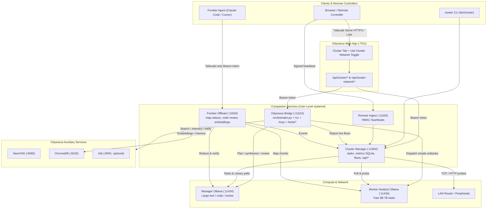

# Odysseus Cluster Network (Optional Companion)

Turn Odysseus into the hub for a multi-machine local LLM cluster — with **chain-of-command model routing**, live device monitoring, **frontier-agent token offload**, and **guided hardware onboarding**.

> **Off by default.** Standard Odysseus installs are completely unaffected unless you set `ODYSSEUS_CLUSTER_ENABLED=1`. When disabled (or when the companion services are stopped), Odysseus hides the Cluster UI and routes chats normally.
>
> Odysseus maintainers evaluating this branch should start with [DEVELOPER_NOTES.md](DEVELOPER_NOTES.md) (core-file touchpoints, API surface, security notes, tests, measured results, known gaps, and a suggested PR split).

---

## Personal note from the author

The update descriptions here are written by AI, specifically by Grok Bot agents. I am creating a cluster network using e-'waste' from a company that has allowed me to use the hardware they have on hand. The idea is that they can increase security by hosting simpler tasks locally instead of sending them directly to an open model, and decrease costs by managing hardware efficiently. If Odysseus is the main entry point, then anything beyond that UI is managed by a viewable device on the cluster network, not a cloud computer. The end game is to prioritize local hardware with a system that is self-managed using LLMs, but that is also set up to adopt better practices with every update from frontier models if necessary. I want to make privacy an option for everybody, even on a budget, and to keep technology diverse instead of everything running on the same few clouds and the newest hardware.

### Long-term vision

As AI keeps getting better, I think the need for Python libraries and high-level languages will move down toward C and compilers, and eventually toward binary that LLMs can tune well enough to turn outdated hardware into power-efficient processing or storage. Odysseus would reach that hardware directly and help optimize it automatically. That's the hope, not something I can promise today. I want old and varied machines to stay useful, so the ecosystem doesn't narrow down to a few vendors and whatever hardware is newest.

---

## What It Includes

1. **Cluster Tab (`ODYSSEUS_CLUSTER_ENABLED=1`)**
   - Live interactive **Chain of Command** SVG map with color-coded flow lines (task dispatch, review, monitoring, alerts, network links, tools, remote control, and frontier offload) that animate when active and filter logs on click.
   - Device cards showing hardware badges, temperatures, power (Watts), VRAM usage, active tasks, loaded/installed Ollama models, and non-LLM devices (routers, handheld/browser controllers, 3D printers, power meters).
   - Side inspector with live logs, task submission, task history (tok/s, J/tok, reviewer verdicts), model stats, and performance time-series charts with a change log.
   - Built-in **Add device** panel for pasting hardware probe output and registering new devices without `sudo`.

2. **Use Cluster Network Toggle (Chat Routing)**
   - Adds a **Use Cluster Network** switch directly above the chat model picker (on by default when enabled).
   - The model picker lists **Cluster Network** first (the routed orchestrator, then the manager's own models) and a **Workers** section under that, with a remembered sub-group per worker machine. Each model has a host badge; offline hosts show a red badge. Replies end with a `ran on <device> · <model>` line, and a remote-session banner appears when you open Odysseus from a controller or another machine, so it is clear that models run on the cluster, not on the device in your hands.
   - Routes messages through the companion bridge (`orchestrator.py`): a manager model classifies each request (`trivial`, `tools`, `direct`, or `plan`), dispatches simple work to fast/worker nodes in parallel, reviews worker outputs (plus source checks for web searches), retries or escalates to the manager on failure, and streams progress in the collapsible thinking block. The final stream chunk includes structured `cluster` metadata (devices and models used) so the footer can name every machine that ran.

3. **Frontier Agent Offload (`:11630`)**
   - An authenticated MCP (`/mcp`) + REST (`/v1/offload/*`) endpoint that lets external coding or chat agents (Claude Code, Cursor, etc.) offload token-heavy reading—summarizing large logs, map-reduce passes over repositories, bulk extraction, and first-pass diffs—to your local cluster, returning compact cited results so the frontier model spends tokens on decisions instead of raw text.

4. **Hardware Onboarding (`onboard/probe.sh` + `advisor.py`)**
   - Portable no-root probe script that inspects CPU, GPU/VRAM, RAM, disk, and network latency to the manager, then recommends a cluster role, models that fit within VRAM, chain-of-command flows, and a checklist.

---

## Architecture



---

## Requirements

- **Odysseus** running via Docker Compose or natively (Python 3.11+).
- **Linux host** for the companion user services (systemd `--user` optional, or run manually).
- **Ollama** installed on the manager node (and on any worker nodes you add), with models pulled that match your `config.json` / `bridge/bridge.json`.
- **Optional:**
  - Odysseus's bundled **SearXNG** (`:8080`) and **ChromaDB** (`:8100`) for web search and cluster memory tools.
  - **ntfy** (`:8091`) for push alerts.
  - **Tailscale** for secure remote access from other devices without opening router ports.

---

## Quick Start

### 1. Try the UI with Mock Data First (Optional)

You can preview the Cluster tab UI inside Odysseus without installing any companion services yet:

```bash
ODYSSEUS_CLUSTER_ENABLED=1 ODYSSEUS_CLUSTER_MOCK=1 docker compose up -d
```

Open Odysseus and click the **Cluster** icon in the left rail (or visit `/cluster`).

### 2. Install the Companion Services (No `sudo`)

From the repository root:

```bash
./contrib/cluster-network/install.sh --dir "$HOME/llm-cluster"
```

`install.sh` never invokes `sudo`. It:
- Copies the manager, bridge, offload, onboarding, remote ingest, and CLI scripts to `$HOME/llm-cluster`.
- Creates `config.json`, `devices.json`, `bridge/bridge.json`, and `offload/offload.json` from the `.example.json` templates (without overwriting existing files).
- Generates fresh 256-bit random tokens in `$HOME/llm-cluster/secret/*.token` (`chmod 600`).
- Sets up a Python virtual environment (`.venv`) with `fastapi`, `uvicorn`, `httpx`, `mcp`, and `starlette`.
- Renders systemd `--user` unit files in `$HOME/llm-cluster/systemd/`.

### 3. Customize Your Configs

Edit the generated files in `$HOME/llm-cluster/`:
- `config.json` — set `node` (your manager name), `bind` IPs, `peer` (your worker IP/Ollama URL), and `models`.
- `devices.json` — list your manager, worker(s), router, and any peripherals (see `devices.example.json`). Optional fields: `label` / `short_label` (picker badges, e.g. `Desktop` or `Mini PC`), `aliases`, `bridge_prefix` (the prefix on worker route ids such as `mini/<model>`), `tailscale_ip`, and `ip_aliases` (used to tell a local session from a remote controller). Example IPs in the template use RFC 5737 documentation ranges.
- `bridge/bridge.json` — verify `nodes.desktop`, `nodes.mini`, and `orchestrator` model names.
- `offload/offload.json` — add your Tailscale IP to `bind` / `allowed_hosts` and list directories you want frontier agents allowed to read in `path_allowlist`.

### 4. Start the Companion Services

```bash
mkdir -p ~/.config/systemd/user
cp "$HOME/llm-cluster/systemd/"*.{service,timer} ~/.config/systemd/user/
systemctl --user daemon-reload
systemctl --user enable --now \
  llm-cluster-manager.service \
  llm-cluster-odysseus-bridge.service \
  llm-cluster-offload.service \
  llm-cluster-remote-ingest.service \
  llm-cluster-selfcheck.timer
```

Check health:

```bash
"$HOME/llm-cluster/bin/cluster" health
curl -sf http://127.0.0.1:11610/health
curl -sf http://127.0.0.1:11630/health
```

### 5. Enable Cluster Network in Odysseus

Use the included Docker Compose overlay alongside `docker-compose.yml`:

```bash
COMPOSE_FILE=docker-compose.yml:contrib/cluster-network/docker-compose.cluster.yml \
ODYSSEUS_CLUSTER_HOME="$HOME/llm-cluster" \
docker compose up -d
```

When Odysseus starts:
- The **Cluster** tab appears in the navigation rail and `/cluster`.
- A shared **Cluster Network** endpoint (`clusternet`) is registered automatically, and the **Use Cluster Network** toggle appears above the chat model picker.

---

## Configuration Reference

### Odysseus Environment Variables

All cluster variables default to off/empty so upstream behavior stays unchanged:

| Variable | Default | Description |
|---|---|---|
| `ODYSSEUS_CLUSTER_ENABLED` | `0` | Master switch (`1` enables Cluster tab routes, UI, and Cluster Network routing). |
| `ODYSSEUS_CLUSTER_NETWORK` | `1` (when enabled) | Set to `0` to keep the Cluster tab enabled without registering the Cluster Network chat toggle. |
| `ODYSSEUS_CLUSTER_API_URL` | `""` | Base URL of the cluster manager HTTP API (e.g. `http://host.docker.internal:11600`). |
| `ODYSSEUS_CLUSTER_API_TOKEN` | `""` | Bearer token for the manager API. Prefer `ODYSSEUS_CLUSTER_API_TOKEN_FILE` in Docker. |
| `ODYSSEUS_CLUSTER_API_TOKEN_FILE` | `/run/secrets/cluster_api_token` | Container path to `secret/api.token`. |
| `ODYSSEUS_CLUSTER_BRIDGE_URL` | `http://host.docker.internal:11610/v1` | OpenAI-compatible `/v1` base URL of the bridge. |
| `ODYSSEUS_CLUSTER_BRIDGE_TOKEN` | `""` | Bearer token for the bridge. Prefer `ODYSSEUS_CLUSTER_BRIDGE_TOKEN_FILE` in Docker. |
| `ODYSSEUS_CLUSTER_BRIDGE_TOKEN_FILE` | `/run/secrets/cluster_bridge_token` | Container path to `secret/bridge.token`. |
| `ODYSSEUS_CLUSTER_DATA_DIR` | `""` | Optional read-only mount path containing `devices.json`, `journal/`, `state/`, and `offload/`. |
| `ODYSSEUS_CLUSTER_LOCAL_DIR` | `<DATA_DIR>/cluster` | Local directory inside Odysseus data storage for UI-logged changes. |
| `ODYSSEUS_CLUSTER_NODES` | `""` | Optional JSON array of node descriptors if running without a manager API. |
| `ODYSSEUS_CLUSTER_TIMEOUT` | `4.0` | Timeout in seconds for manager API requests from Odysseus. |
| `ODYSSEUS_CLUSTER_MOCK` | `0` | Set to `1` to serve synthetic RFC 5737 demo nodes for UI testing. |
| `ODYSSEUS_CLUSTER_NETWORK_GATE` | `0` | Set to `1` to force the Odysseus completion gate to run on `cluster-network` turns. |

### Companion Configuration Files

- `config.json` — manager ports, node IDs, peer worker address, model defaults, timeouts, and alert thresholds.
- `devices.json` — device inventory for the Cluster tab and the model picker (compute nodes, routers, controllers, printers, power meters). Host badges and the remote-session banner read `label`, `aliases`, `bridge_prefix`, `tailscale_ip`, and `ip_aliases` from this file.
- `bridge/bridge.json` — bridge bind addresses, `allow_cidrs`, orchestrator settings (`max_subtasks`, `fix_rounds`, context sizes), and Odysseus service URLs.
- `offload/offload.json` — offload bind addresses, `allowed_hosts` / `allowed_origins`, rate/size limits, `path_allowlist`, and `path_denylist_globs`.

When the feature is enabled, Odysseus also exposes:

- `GET /api/cluster-network/hosts` — manager and worker catalogs, chat models, route ids, online state, and the current browser `session`.
- `GET /api/cluster-network/session` — `{remote, client_device_id, client_name, label}` for the remote-session banner (also included on `/config` and `/hosts`).

Both routes return `enabled: false` (and an empty catalog) when `ODYSSEUS_CLUSTER_ENABLED` is off, so the picker stays unchanged.

---

## Security Model

- **Generated secrets, never committed:** `install.sh` creates separate 256-bit random tokens in `secret/{cluster,api,bridge,offload,remote}.token` with `0600` permissions (`0700` directory).
- **Loopback-first binding:** By default, the manager, bridge, and offload services bind to `127.0.0.1` (plus `172.17.0.1` on the bridge for Docker containers) and reject non-matching source CIDRs (`allow_cidrs`).
- **Authenticated APIs:** All manager `/api/*` endpoints, bridge `/v1/*` and `/mcp` endpoints, and offload `/v1/offload/*` and `/mcp` endpoints require Bearer tokens. Worker and remote controller heartbeats use HMAC-SHA256 signatures with timestamp skew checks.
- **Zero-sudo runtime:** All companion services run as unprivileged systemd `--user` units. The onboarding advisor never executes `sudo`; any suggested host firewall steps are printed as copy-paste commands with undo commands.
- **Secret file protection in Offload:** `offload_engine.py` enforces `path_allowlist` plus `path_denylist_globs` (`**/secret/**`, `**/*.token`, `**/.env*`, `**/.git/**`, virtualenvs, and SQLite state) so external agents cannot read credentials.
- **Tailscale-only remote access by default:**
  - `net/TAILSCALE_DESKTOP.sh.example` exposes Odysseus over HTTPS strictly inside your Tailscale tailnet (`tailscale serve`), never on the public internet.
  - `net/OFFLOAD_FUNNEL.sh.example` is an **explicit opt-in** for exposing `:11630` over Tailscale Funnel (`:8443`) for cloud-hosted agents. Enabling Funnel makes your offload port reachable from the public internet—anyone who obtains your `offload.token` could read `path_allowlist` files and run GPU jobs on your machine. Keep Funnel off unless you specifically need cloud agents.
- **Optional host firewall:** `net/cluster-guard.nft.example` restricts `:11600` to loopback, your worker IP, and Docker bridges (`172.16.0.0/12`).

---

## Adding Devices

You can onboard new hardware (GPU workstations, mini PCs, Raspberry Pis, handheld controllers, routers, or HTTP-polled peripherals like Klipper printers and Shelly power meters) without guessing model sizes:

1. Copy `onboard/probe.sh` to the new Linux device and run it (no root required):
   ```bash
   CLUSTER_MANAGER=http://<MANAGER_IP>:11600 ./probe.sh --pretty > /tmp/cluster-probe.json
   ```
2. Either:
   - Open the **Cluster** tab in Odysseus, click **Add device**, paste or upload `/tmp/cluster-probe.json`, review the recommendation, and click **Register device**, **or**
   - Run the CLI on the manager host:
     ```bash
     "$HOME/llm-cluster/bin/cluster" onboard /tmp/cluster-probe.json
     "$HOME/llm-cluster/bin/cluster" onboard --apply /tmp/cluster-probe.json
     ```
3. See [`onboard/ONBOARDING.md`](onboard/ONBOARDING.md) for the full device-class playbook (GPU boxes, APUs, SBCs, NAS boxes, printers, cameras, and power meters).

---

## Connecting Frontier Agents (Claude Code / Cursor) to Offload

Start `llm-cluster-offload.service`, add your Tailscale IP (if connecting from another machine on your tailnet) to `offload/offload.json` (`bind`, `allowed_hosts`, `allowed_origins`), and add your workspace directories to `path_allowlist`.

Copy your token from `$HOME/llm-cluster/secret/offload.token`, then configure your MCP client:

**Claude Code (`~/.claude.json` or project `.mcp.json`):**

```json
{
  "mcpServers": {
    "llm-cluster-offload": {
      "type": "http",
      "url": "http://127.0.0.1:11630/mcp",
      "headers": {
        "Authorization": "Bearer <PASTE_OFFLOAD_TOKEN>"
      }
    }
  }
}
```

**Cursor (`~/.cursor/mcp.json`):**

```json
{
  "mcpServers": {
    "llm-cluster-offload": {
      "url": "http://127.0.0.1:11630/mcp",
      "headers": {
        "Authorization": "Bearer <PASTE_OFFLOAD_TOKEN>"
      }
    }
  }
}
```

*(Replace `127.0.0.1` with your Tailscale IP/DNS name when calling from another machine on your tailnet.)*

Available MCP tools: `offload_summarize`, `offload_map_extract`, `offload_review_code`, `offload_memory_search`, `offload_embed`, and `offload_status`.

---

## Limitations and Known Gaps

- **Local reasoning ceiling:** Small local models (3B–12B) are great at summarizing, extracting, and drafting, but weaker than frontier models on complex multi-step reasoning. Keep the boundary clear: let the cluster read and condense, and let the manager or frontier model make final decisions.
- **Single-manager topology:** The current manager assumes one primary manager node coordinating one or more workers; high-availability multi-manager failover is not implemented.
- **Worker pull agent:** The companion bundle ships the manager, bridge, offload, onboarding, remote ingest, and CLI. Worker nodes only need Ollama reachable from the manager (plus optional outbound HMAC agent deployment described in `onboard/ONBOARDING.md`).
- **Auxiliary services:** Web search (`web_search`), cluster memory (`memory_query`/`memory_store`), and push notifications (`notify`) in the bridge expect Odysseus's SearXNG, ChromaDB, and an optional ntfy instance; if any are omitted, those specific tools degrade gracefully with an error status while model routing continues to work.

---

## Disabling or Removing Cluster Network

To turn the feature off in Odysseus without touching your companion files:

1. Remove `contrib/cluster-network/docker-compose.cluster.yml` from `COMPOSE_FILE` (or set `ODYSSEUS_CLUSTER_ENABLED=0` in `.env`) and restart Odysseus:
   ```bash
   docker compose up -d
   ```
2. Optionally stop the user-level companion services:
   ```bash
   systemctl --user disable --now \
     llm-cluster-manager.service \
     llm-cluster-odysseus-bridge.service \
     llm-cluster-offload.service \
     llm-cluster-remote-ingest.service \
     llm-cluster-selfcheck.timer
   ```
